<p align="center">
  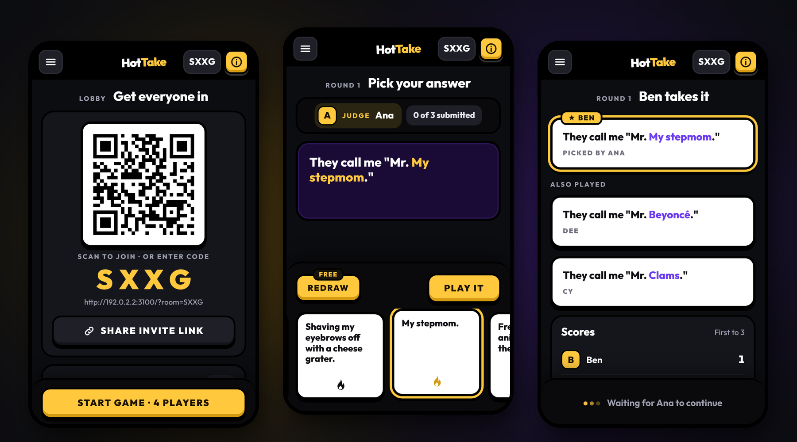
</p>

# Hot Take

**A party card game you play on your phones.** One player is the judge and reads a prompt card. Everyone
else secretly plays their funniest answer card, and the judge picks a winner. It's the same game as
Cards Against Humanity or Apples to Apples, played the way Jackbox games work: one small server, and
everyone joins from their own phone's browser. No app to install, no TV, no accounts.

- **Join in seconds.** Scan the QR code on the host's screen, or type a 4-letter room code.
- **Built for phones.** Big tap targets, a swipeable hand of cards, the screen stays awake mid-game, and Android phones vibrate when it's your turn.
- **Twelve decks out of the box**, starting with a kid-safe Family Edition as the default (card text from Cards Against Humanity, see [Credits](#credits-and-licenses)).
- **Survives real-world phones.** Lock your screen or lose Wi-Fi and you keep your seat and score for 2 minutes; reopening the link puts you right back.
- **Runs anywhere.** One Docker container, or `npm start`. Works on a home network with no internet connection.

---

## Contents

- [Quick start](#quick-start)
- [Getting everyone connected](#getting-everyone-connected)
- [How to play](#how-to-play)
- [Host controls](#host-controls)
- [Decks](#decks)
- [Configuration](#configuration)
- [How it works](#how-it-works)
- [Development](#development)
- [Troubleshooting](#troubleshooting)
- [Credits and licenses](#credits-and-licenses)

---

## Quick start

### Docker stack (recommended)

A ready-made image is published to GitHub Container Registry on every push to `main`, for
`linux/amd64` and `linux/arm64` (Raspberry Pi and ARM NAS boxes included).
[`compose.stack.yml`](compose.stack.yml) pulls it, so there's nothing to build:

- **Portainer, Dockge, Komodo, CasaOS…** create a new stack and paste in the contents of `compose.stack.yml`.
  Set `PUBLIC_URL` to the address phones will use, e.g. `http://192.168.1.20:3000`.
- **Command line:**

  ```bash
  curl -O https://raw.githubusercontent.com/mhudrlik/hot-take/main/compose.stack.yml
  PUBLIC_URL=http://192.168.1.20:3000 docker compose -f compose.stack.yml up -d
  ```

The stack file exposes every setting as a variable with a sensible default (`HOT_TAKE_PORT`, `PUBLIC_URL`,
and the ones under [Configuration](#configuration)). It also runs hardened: read-only filesystem, non-root
user, no privilege escalation, and capped logs.

### Docker, built from source

```bash
git clone https://github.com/mhudrlik/hot-take.git
cd hot-take
docker compose up -d --build
```

Hot Take is now running on port **3000**. Check it with `curl http://localhost:3000/healthz`.

### Node.js

Requires Node 20 or newer.

```bash
git clone https://github.com/mhudrlik/hot-take.git
cd hot-take
npm install
npm start
```

### Then

1. On the host's phone or laptop, open `http://<this-computer's-IP>:3000` and tap **Start a new game**.
2. Everyone else scans the QR code in the lobby (or opens the same address and types the room code).
3. When 3 or more players are in, the host taps **Start game**.

---

## Getting everyone connected

<table>
  <tr>
    <td width="33%">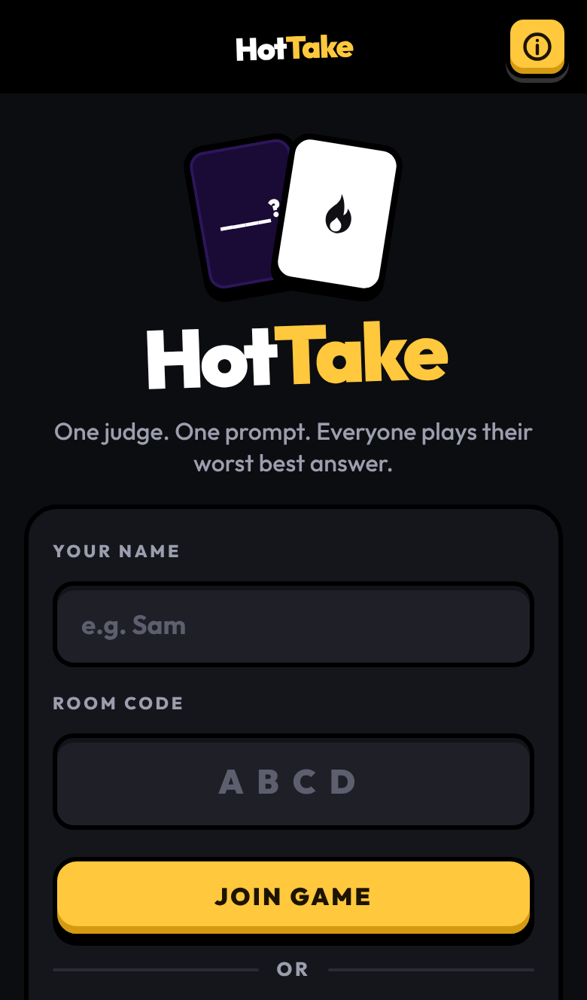</td>
    <td width="33%">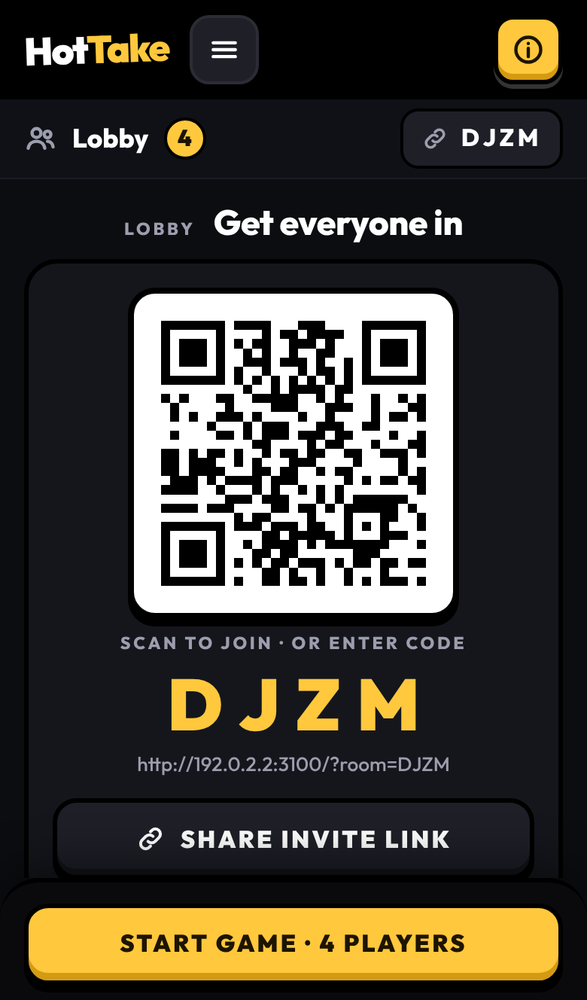</td>
    <td width="33%">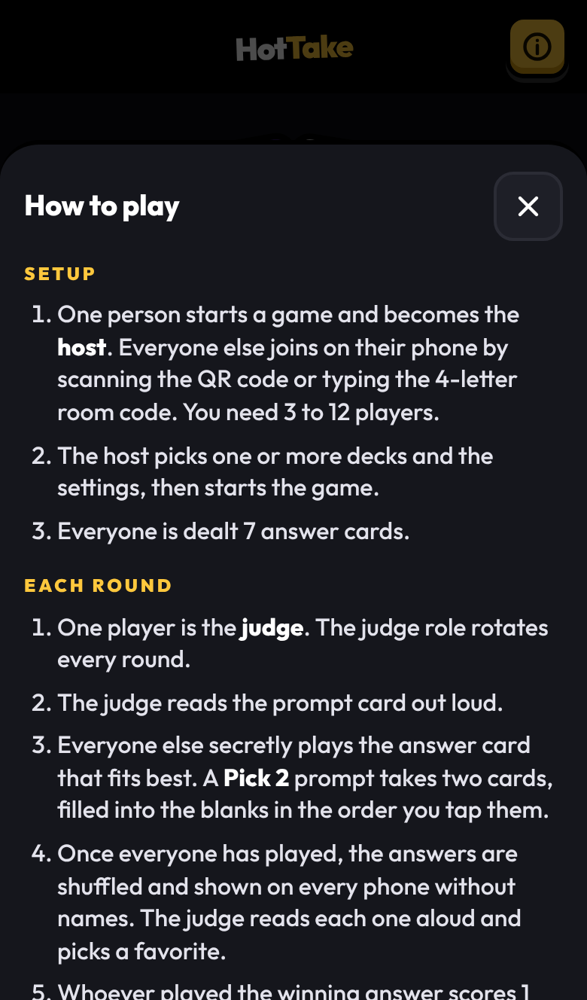</td>
  </tr>
  <tr>
    <td align="center"><b>Home.</b> Enter a name, then join or start a game.</td>
    <td align="center"><b>Lobby.</b> Others scan the QR code with their camera app.</td>
    <td align="center"><b>Rules.</b> The yellow (i) button opens them anywhere.</td>
  </tr>
</table>

Phones must be able to reach the server, which usually means **everyone is on the same Wi-Fi**.
The QR code and invite link always encode an address other phones can use:

| How the host opened the game | What the QR code points to |
|---|---|
| A LAN IP or domain, e.g. `http://192.168.1.20:3000` | That same address |
| `localhost`, with `npm start` | This computer's LAN IP, detected automatically |
| `localhost`, with **Docker** | The container can't see your LAN IP, so the lobby shows a warning. Open the game via the LAN IP instead, or set `PUBLIC_URL`. |
| Behind a reverse proxy | The public address, taken from `X-Forwarded-Proto` / `X-Forwarded-Host` |

To set the address explicitly, uncomment `PUBLIC_URL` in `docker-compose.yml`:

```yaml
environment:
  PUBLIC_URL: http://192.168.1.20:3000
```

**Playing over the internet** (friends in different houses): put the container behind any HTTPS
reverse proxy (Caddy, Traefik, nginx, Cloudflare Tunnel) or deploy it to a container host such as
Fly.io, Render or Railway. The proxy must forward WebSocket upgrades. HTTPS also turns on two features
phones only allow on secure pages: keeping the screen awake, and the native share sheet.

> Run a **single instance**. Game state lives in memory, so two copies behind a load balancer would split players between them.

---

## How to play

<table>
  <tr>
    <td width="33%">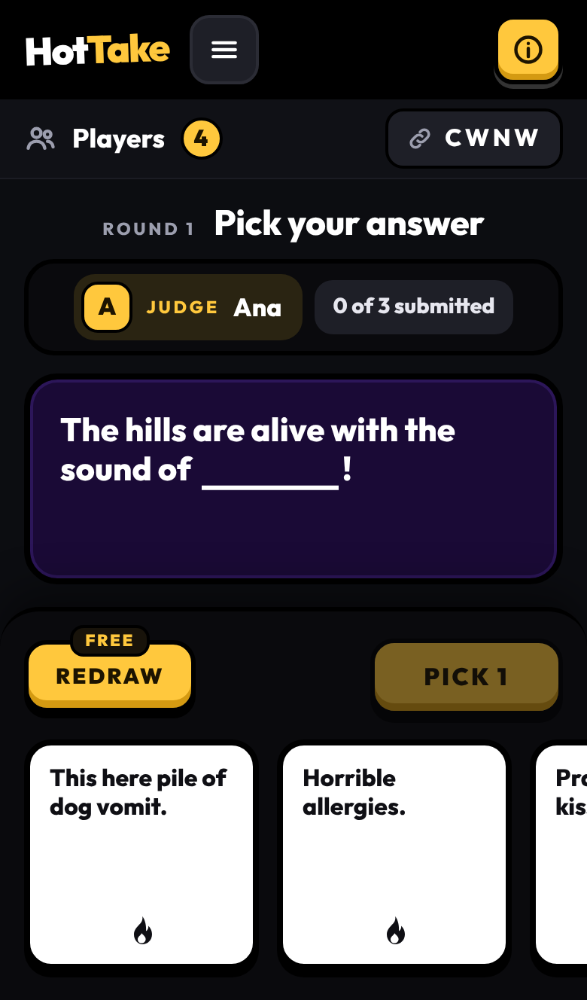</td>
    <td width="33%">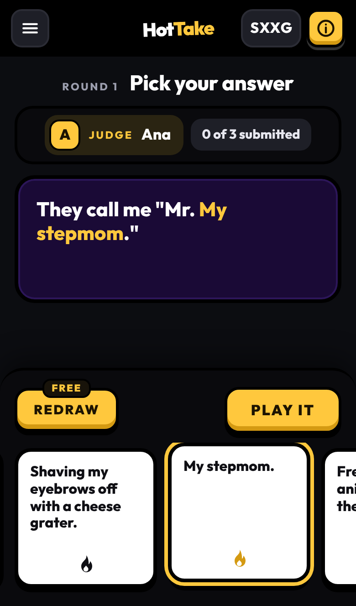</td>
    <td width="33%">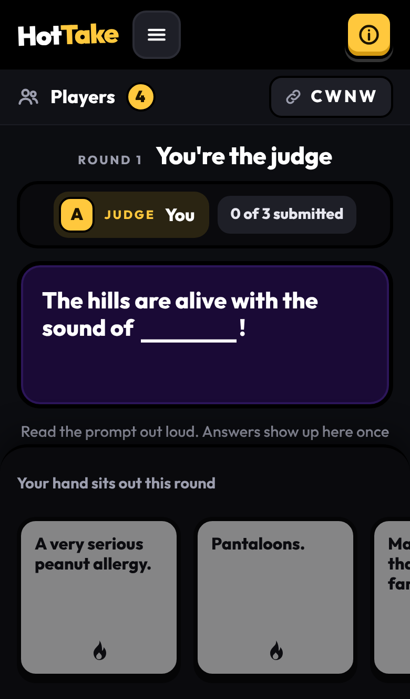</td>
  </tr>
  <tr>
    <td align="center"><b>1. Pick.</b> Swipe through your hand.</td>
    <td align="center"><b>2. Preview.</b> Your card fills the blank; tap <b>Play it</b>.</td>
    <td align="center"><b>The judge</b> reads the prompt aloud and waits.</td>
  </tr>
  <tr>
    <td>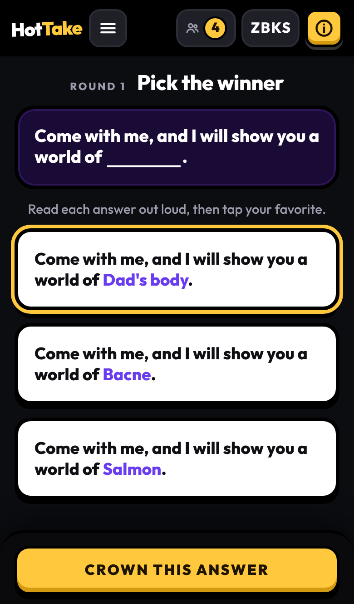</td>
    <td>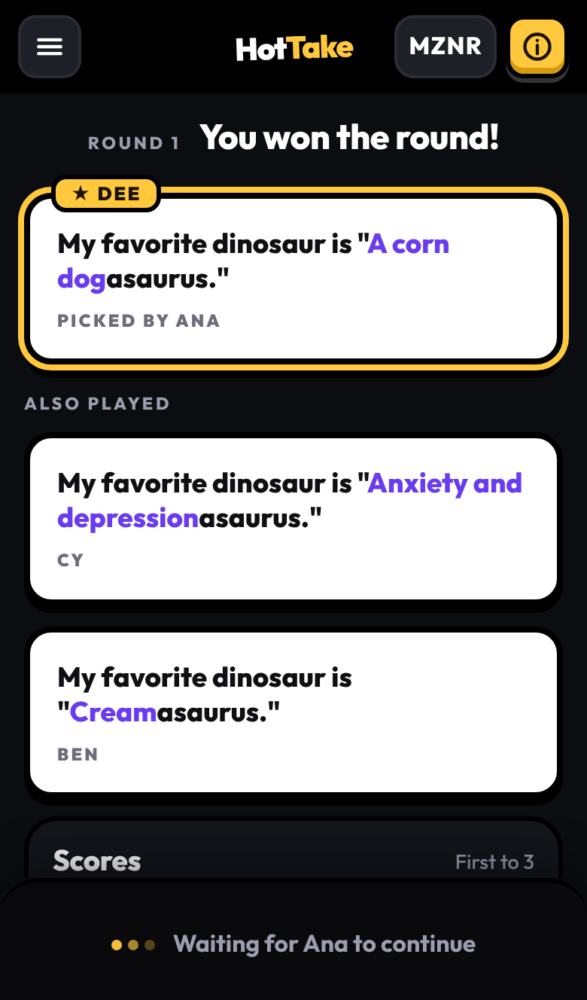</td>
    <td>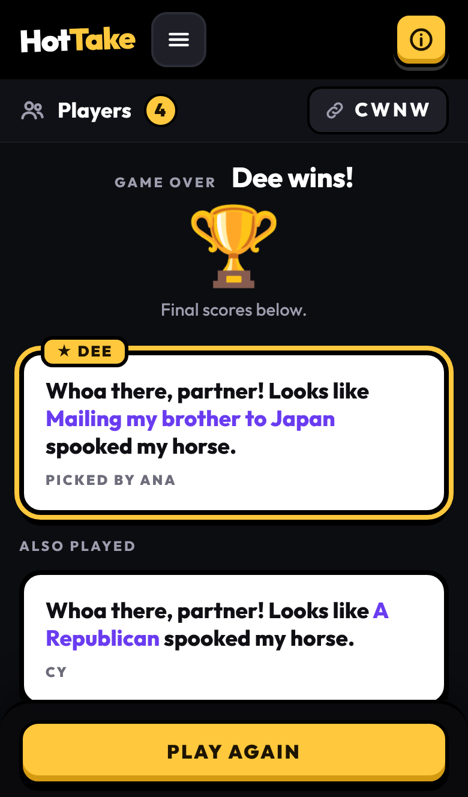</td>
  </tr>
  <tr>
    <td align="center"><b>3. Judge.</b> Answers are anonymous. The judge reads them aloud and crowns one.</td>
    <td align="center"><b>4. Reveal.</b> Everyone sees who played what.</td>
    <td align="center"><b>5. Win.</b> First to the target score takes it.</td>
  </tr>
</table>

### Rules

1. **3 to 12 players.** Everyone holds a hand of answer cards (7 by default).
2. Each round, one player is the **judge**. The role rotates every round in join order.
3. The judge reads the **prompt card** aloud.
4. Everyone else secretly plays the answer card that fits best. **Pick 2** and **Pick 3** prompts take that many cards, filled into the blanks in the order you tap them.
5. When every connected player has played, the answers are shuffled and shown on every phone **without names**. The judge reads each one aloud and picks a favorite.
6. Whoever played it scores **1 point**. Hands refill and the next judge is up.
7. The first player to the target score (7 by default) **wins**.

### Special moves

| Move | Cost | What it does |
|---|---|---|
| **Redraw** (mulligan) | Free, once per game | Throw back your whole hand and draw a new one. You never get your old cards back. |
| **Trade** | 1 point | Same thing, any number of times, after your free redraw is used. |

You can use either while cards are being played, as long as you haven't played yet and aren't the judge.

### Fair play

- Every answer card in a deck is unique, and a player can't play an answer identical to one already played that round, so two players never play the same answer.
- Nobody else's hand ever reaches your phone, and the server doesn't reveal who played which answer until the judge has picked.

---

## Host controls

<table>
  <tr>
    <td width="33%">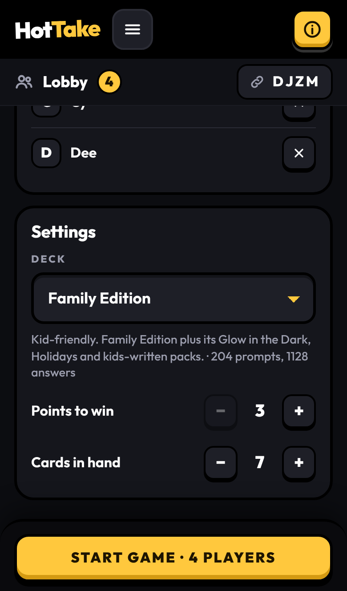</td>
    <td width="33%">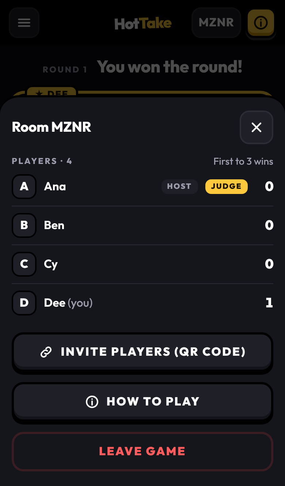</td>
    <td width="33%">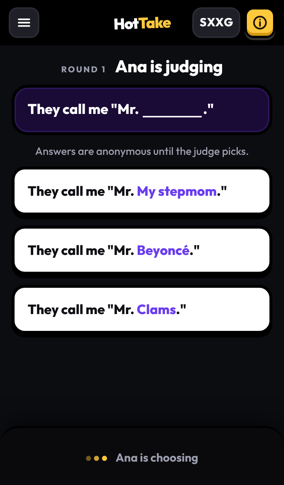</td>
  </tr>
  <tr>
    <td align="center"><b>Settings.</b> One or more decks, points to win (3–20), cards in hand (5–12).</td>
    <td align="center"><b>Menu.</b> Scores, invite QR, rules, remove players, skip a round.</td>
    <td align="center"><b>Everyone</b> follows along on their own phone.</td>
  </tr>
</table>

The top bar is always visible during a game: **☰** on the left opens the players, scores and menu; the
**room code** on the right shows the invite QR code for late joiners; and the yellow **(i)** opens the rules.

The first player to create the room is the **host**. The host can:

- choose one or more **decks** and the **settings** (only between games),
- **start** the game once 3 players are connected, and **play again** after it ends,
- **remove** a player (the × next to their name),
- **skip a round**, for when the judge's phone dies. Nobody scores and played cards go back to their owners.

If the host leaves, host passes to the next player.

### When phones misbehave

| What happens | What the game does |
|---|---|
| A phone locks, loses Wi-Fi, or the page reloads | The player keeps their seat and score for 2 minutes. Reopening the link rejoins automatically. |
| A disconnected player hasn't played yet | The round doesn't wait for them. |
| The judge leaves | The round is voided, played cards go back to their owners, and the next judge starts a fresh round. |
| Fewer than 3 players remain | The game returns to the lobby. |
| Someone joins mid-game | They're dealt in immediately and can play this round. |
| The same player opens the game in a second tab | The newer tab takes over; the old one offers "Play here instead". |

---

## Decks

Nineteen decks ship in `data/decks/`. **Family Edition is listed first and is the default**, so every new
room starts kid-safe, followed by seven original themed decks that are also family-friendly and safe for work.

**The host can tick any number of decks** in the lobby, and the game shuffles them into one pile. That's handy
for a big group or a long game (try 2000s + '90s Nostalgia for a throwback night). A card that appears in more
than one selected deck is only dealt once, and the lobby shows the combined total so you can see how many cards
you've got. At least one deck must stay selected.

### Family-friendly and safe for work

| Deck | Prompts | Answers | What's in it |
|---|---:|---:|---|
| **Family Edition** (default) | 204 | 1,128 | Cards Against Humanity's kid-friendly edition and its packs |
| Disney | 55 | 220 | Princesses, villains, Pixar, theme parks and sing-alongs |
| Nerd Alert | 55 | 206 | Video games, D&D, sci-fi, comics, science and tech support |
| '90s Nostalgia | 55 | 202 | Tamagotchis, dial-up, boy bands, Saturday cartoons and Y2K panic |
| 2000s Nostalgia | 55 | 211 | Flip phones, MySpace, iPods, Wii Sports and Disney Channel movies |
| Office Life | 60 | 217 | Meetings, reply-all, the office fridge and corporate buzzwords |
| Holidays & Family Gatherings | 56 | 211 | The kids' table, ugly sweaters, road trips and white elephant gifts |
| Snack Attack | 56 | 245 | Pizza debates, cereal mascots, cooking fails and the last slice |

The seven themed decks are original writing for Hot Take. They avoid innuendo, bathroom humor, alcohol, violence,
religion and politics, and the test suite fails if a banned word ever slips into one of them.

### Adults only

| Deck | Prompts | Answers | Notes |
|---|---:|---:|---|
| Main Deck | 100 | 500 | Current US base game (v3.0) |
| Classic Main Deck | 90 | 460 | Original US base game (v1.7) |
| More Cards Against Humanity | 135 | 465 | |
| Absurd Box | 48 | 260 | |
| Hot Box | 40 | 260 | |
| Super Box | 54 | 246 | |
| Everything Box | 50 | 250 | |
| Red, Green & Blue Boxes | 246 | 894 | The classic expansions (originally First–Sixth) |
| Theme Packs & Promos | 274 | 1,644 | Every small themed, holiday, PAX and promo pack, mixed |
| Clams Aclamst Huclamity | 100 | 500 | Clam-themed parody edition |
| Everything | 859 | 4,279 | All the adult decks above combined |

Every deck has enough cards for the largest possible game (12 players with 12-card hands); the test suite checks this.

### Rebuilding the decks

The decks are generated from a
[community-maintained master list](https://docs.google.com/spreadsheets/d/1-PqZiIjliCu0B1J0V6nq-V72b_-NFieeIJ0hC6WgrPk)
by a dependency-free script:

```bash
node scripts/import-cah-decks.js              # download the sheet and rebuild every deck
NODE_USE_ENV_PROXY=1 node scripts/import-cah-decks.js   # same, behind an HTTP(S) proxy
node scripts/import-cah-decks.js --from DIR   # build from CSVs already saved as DIR/<tab>.csv
```

The script:

- uses **one printing** of the base game instead of mixing every region and edition,
- removes duplicate cards (many expansions reprint each other),
- keeps line breaks, since many prompts are poems, lists or letters,
- reads **PICK 2** / **DRAW 2, PICK 3** from the sheet,
- skips picture-only cards and the handful too long to fit on a phone (prompts over 280 characters, answers over 160),
- leaves out tabs that aren't standard prompt/answer decks: Tales, Explains the Joke, Twists, the procedurally generated cards and the regional conversion kits.

The deck list and grouping live in the `DECKS` array at the top of the script. Re-running it only replaces the
decks the script itself generates, so the themed decks and any hand-made decks in `data/decks/` are left alone.

### Making your own deck

Every `*.json` file in `data/decks/` is a deck. Files are sorted by name (the first is the default), and the
filename is the deck's id.

```json
{
  "name": "Office Party",
  "description": "Safe for work. Mostly.",
  "prompts": [
    { "text": "My secret talent is ____.", "pick": 1 },
    { "text": "____ + ____ = disaster.", "pick": 2 },
    { "text": "Roses are red,\nviolets are blue,\n____." , "pick": 1 }
  ],
  "answers": ["A soggy waffle.", "Tax season.", "Reply-all."]
}
```

- Write blanks as three or more underscores (`____`); answers are filled into them on screen. A prompt with no blank gets the answer appended.
- `pick` is 1, 2 or 3.
- `\n` in card text becomes a line break on the card.
- Duplicate cards (ignoring case and spacing) are dropped on load, with a warning in the server log.
- You need at least `players × (hand size + 2)` answer cards. Discards are reshuffled, so a bigger deck just means fewer repeats.
- Decks load at startup, so restart after editing. With Docker, uncomment the `volumes` entry in `docker-compose.yml` to use your local `data/decks` folder without rebuilding the image.

---

## Configuration

All settings are environment variables.

| Variable | Default | Meaning |
|---|---|---|
| `PORT` | `3000` | Port to listen on |
| `PUBLIC_URL` | auto-detected | Base URL encoded in invite links and QR codes, e.g. `http://192.168.1.20:3000` |
| `DECKS_DIR` | `data/decks` | Folder of deck files |
| `DISCONNECT_GRACE_MS` | `120000` | How long a dropped phone keeps its seat (ms) |
| `ROOM_IDLE_MS` | `7200000` | Rooms with nobody connected are deleted after this long (ms) |
| `MAX_ROOMS` | `200` | Maximum concurrent rooms |

The image runs as a non-root user and has a health check on `GET /healthz`.

If Docker Hub rate-limits your build, pull the base image from a mirror:

```bash
docker build --build-arg NODE_IMAGE=mirror.gcr.io/library/node:22-alpine -t hot-take .
```

---

## How it works

```
 phones (browser)                     server (Node.js)
┌──────────────┐   Socket.IO   ┌──────────────────────────────┐
│ public/      │◄─────────────►│ server/index.js              │
│  app.js      │  per-player   │  rooms, room codes, invites, │
│  style.css   │  state views  │  reconnect tokens, timers    │
│  rules.js    │               │            │                 │
└──────────────┘               │ server/game.js               │
                               │  rules engine (pure state    │
        GET /qr.svg ──────────►│  machine, no networking)     │
        GET /api/invite        │            ▲                 │
                               │ data/decks/*.json            │
                               └──────────────────────────────┘
```

- **`server/game.js`** is the rules engine: a pure state machine with no networking, which makes it easy to unit-test.

  ```
  lobby → submitting → judging → reveal → submitting → … → gameOver → (play again)
  ```

  Every illegal move (playing as the judge, playing a card you don't hold, picking twice) is rejected on the server, whatever the phone sends.
- **Each phone gets only its own view of the game.** Other players' hands, reconnect tokens, and who played which answer never leave the server until the reveal.
- **`server/index.js`** handles Express and Socket.IO:
  - 4-letter room codes made only of consonants, so they can't spell words, and without look-alike characters,
  - reconnect tokens kept in the phone's local storage,
  - the 2-minute grace timer for dropped phones and the sweeper that deletes idle rooms,
  - the invite endpoints. The server draws the QR code itself, so it works without internet.
- **`public/`** is plain HTML, CSS and JavaScript with no build step. A few phone-specific details:
  - Updates triggered by other players are held while your finger is on the screen, so a tap is never lost to a re-render.
  - The hand keeps its scroll position between updates.
  - The font is bundled locally.

### Project layout

```
hot-take/
├── server/
│   ├── index.js            # HTTP + Socket.IO server, rooms, invites
│   └── game.js             # rules engine
├── public/
│   ├── index.html          # app shell
│   ├── app.js              # client: rendering and input
│   ├── style.css           # theme (colors are CSS variables at the top)
│   ├── rules.js            # rules text, shared by the pop-over and /rules
│   ├── rules.html          # standalone rules page
│   └── fonts/              # Outfit (OFL)
├── data/decks/             # deck JSON files + ATTRIBUTION.md
├── scripts/
│   ├── import-cah-decks.js # rebuilds data/decks from the master list
│   └── take-screenshots.js # regenerates docs/screenshots (npm run screenshots)
├── test/                   # node:test suites
├── docs/screenshots/       # images used in this README
├── .github/workflows/
│   └── docker-publish.yml  # tests, then publishes the image to ghcr.io
├── Dockerfile
├── docker-compose.yml      # build from source
└── compose.stack.yml       # pull the published image (for stacks)
```

---

## Development

```bash
npm install
npm run dev    # restarts the server when files change
npm test       # 30 tests: rules engine, decks, sockets, invite endpoints
```

The tests cover:
- **rules engine:** judge rotation, scoring and game end, pick-2 validation, no duplicate cards anywhere, mulligan and trade, judge or host leaving mid-round, reshuffling when the deck runs out, choosing and combining decks;
- **socket integration test:** three simulated phones play a round, drop, reconnect to the same seat, and time out;
- **endpoints:** the QR code and invite URLs, including behind a reverse proxy;
- **shipped decks:** every deck in `data/decks/` is valid and large enough for a full game.

To change the look, edit the CSS variables at the top of `public/style.css`. To change the rules text, edit `public/rules.js`.

### Regenerating the README screenshots

After a UI change, refresh every image in `docs/screenshots/` (including the banner) with:

```bash
npx playwright install chromium   # once
npm run screenshots
```

The script starts its own server on a free port and plays a scripted four-phone game on the default deck,
replaying until the first round is "showcase" quality: the filled-in prompt fits above the hand without
scrolling, and the cards on screen are free of bathroom, body and similar jokes. That filter is only used
for the screenshots; the game itself is unaffected. A run usually takes a few minutes. It writes to a temp
folder first, so a failed run never leaves a half-updated set. The lobby shows `http://192.168.1.20:3000`
rather than your real address.

### Publishing the Docker image

[`.github/workflows/docker-publish.yml`](.github/workflows/docker-publish.yml) runs the tests, then builds and pushes
`ghcr.io/mhudrlik/hot-take` for `linux/amd64` and `linux/arm64`. It can also be started by hand from the Actions tab.

| Event | Image tags |
|---|---|
| Push to `main` | `latest`, `sha-<short commit>` |
| Tag `1.2.3` (or `v1.2.3`) | `1.2.3`, `1.2`, `1` |

`latest` follows `main`, so it changes with every push. For a stack that only updates when you choose, pin a
release instead, e.g. `image: ghcr.io/mhudrlik/hot-take:1` (any 1.x release) or `:1.0.0` (exactly that one).

### Releasing a version

Versions follow [semantic versioning](https://semver.org):

- **major** for anything that breaks an existing setup (env vars, deck format, ports, volumes),
- **minor** for new features,
- **patch** for fixes.

```bash
npm version 1.1.0 --no-git-tag-version   # keep package.json in step with the tag
git commit -am "Release 1.1.0"
git tag -a 1.1.0 -m "Hot Take 1.1.0"
git push origin main 1.1.0
```

Or on GitHub: **Releases → Draft a new release → Choose a tag**, type `1.1.0`, **Create new tag on publish**, then
**Publish release**. Either way, the workflow then publishes the `1.1.0`, `1.1` and `1` images.

---

## Troubleshooting

| Problem | Fix |
|---|---|
| The lobby says other phones can't reach `localhost` | Open the game using the computer's LAN IP, or set `PUBLIC_URL`. |
| Phones can't load the page at all | Make sure they're on the same Wi-Fi (not guest Wi-Fi or mobile data), and that the computer's firewall allows inbound connections on port 3000. |
| The QR code opens the wrong address | Set `PUBLIC_URL` to the address phones should use. |
| Phones dim or sleep during the game | Browsers only allow keeping the screen awake over HTTPS. Use a reverse proxy with HTTPS, or raise the phone's auto-lock time. |
| "Share invite link" shows the URL instead of a share menu | Same cause: the share sheet needs HTTPS. Copy the link, or scan the QR code. |
| A red "Reconnecting…" bar appears | The phone lost its connection. It rejoins automatically, and your seat is held for 2 minutes. |
| `docker build` fails with `429 Too Many Requests` | Docker Hub is rate-limiting you. Build with `--build-arg NODE_IMAGE=mirror.gcr.io/library/node:22-alpine`. |
| A deck edit doesn't show up | Decks load at startup. Restart the server, or the container if you mounted `data/decks`. |

### Known limitations

- Game state is kept in memory: restarting the server ends any games in progress, and only one instance can run at a time.
- A very long prompt combined with a long answer can run under the card dock on small phones; scroll the prompt area to read it all.
- There's no in-app QR scanner. Phone cameras already scan QR codes, and browsers only allow camera access over HTTPS.

---

## Credits and licenses

- **Card text:** [Cards Against Humanity](https://www.cardsagainsthumanity.com), used under
  [Creative Commons BY-NC-SA 4.0](https://creativecommons.org/licenses/by-nc-sa/4.0/). That means:
  - credit Cards Against Humanity,
  - **non-commercial use only**,
  - share modified decks under the same license.

  See [`data/decks/ATTRIBUTION.md`](data/decks/ATTRIBUTION.md). Hot Take is not affiliated with or endorsed by Cards Against Humanity LLC.
- **Deck sources:** the community-maintained card list linked above.
- **Font:** [Outfit](https://github.com/Outfitio/Outfit-Fonts), SIL Open Font License 1.1 ([`public/fonts/OFL-Outfit.txt`](public/fonts/OFL-Outfit.txt)).
- **Libraries:** [Express](https://expressjs.com), [Socket.IO](https://socket.io), [node-qrcode](https://github.com/soldair/node-qrcode).
- **Code:** no open-source license has been chosen yet (`"license": "UNLICENSED"` in `package.json`), so all rights are reserved by default.
